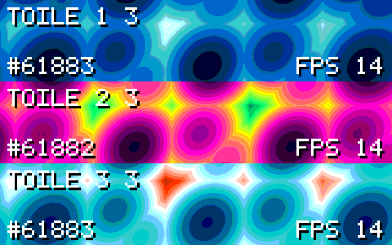

# Toile

**Toile** est un pilote **virtio-gpu 2D** pour **QNX 8.0 en invité** (VM QEMU),
accompagné du **display driver Screen** qui s'appuie dessus. Projet candidat au
**QNX Global Hackathon 2026**, catégorie *Low-level Software*, bonus *Best use of
QNX-specific Technologies*. Licence [MIT](LICENSE).

**Site du projet : <https://tradoooo.github.io/toile/>**

[](https://github.com/Tradoooo/toile/actions/workflows/ci.yml)
[](https://github.com/Tradoooo/toile/actions/workflows/ci-budget.yml)



*Vitrine live : trois clients de l'invite peignent le meme framebuffer
`virtio-gpu` a 30 im/s, l'emulateur affiche le resultat — capture reelle de la
vitrine ([page Live](https://tradoooo.github.io/toile/emulator-live.html)).*

---

## Le problème

Une VM QNX démarre sous QEMU. Le noyau monte, les services partent… et **il n'y a
pas d'image**. Console série uniquement.

La raison est simple : Screen, le serveur graphique de QNX, a besoin d'un pilote
d'affichage, et QNX ne fournit **ni périphérique virtuel virtio-gpu côté
hyperviseur, ni display driver Screen pour un GPU virtuel en invité**. Résultat :
dans une VM, Screen est inutilisable **sans passthrough matériel** — et le
passthrough est lourd, lié à l'hyperviseur, non portable, et exige une carte
dédiée. C'est le trou le plus cité de tout notre inventaire (`G3`, voir
[`docs/GAP.md`](docs/GAP.md)).

Tous ceux qui développent, enseignent, testent ou valident une IHM QNX sont
concernés : pas de graphique en VM, donc pas d'itération rapide, pas de CI
graphique, pas de TP, pas de validation sur poste standard.

## La promesse

> Un développeur QNX démarre une VM sur son portable et voit un **bureau QNX
> complet** s'afficher dans une fenêtre — sans carte graphique dédiée, sans
> passthrough, sans seconde machine.

Le maillon manquant n'est pas énorme : QEMU fournit déjà le périphérique
`virtio-gpu-pci`, et le transport virtio pour QNX 8.0 est déjà écrit dans le
projet frère **Passerelle**. Toile n'écrit que ce qui n'existe nulle part : la
couche virtio-gpu invité et le display driver Screen au-dessus.

## Les trois niveaux d'ambition

- **S — socle** (livrable au 15/12/2026) : virtio-gpu 2D minimal, scanout unique,
  flush, Screen basique en invité QEMU, cœur portable testé sans cible.
- **C — complet** (3 mois) : multi-scanout, curseur matériel, suivi de dommages,
  double tampon + vsync, virtio-input clavier/souris, intégration Screen complète.
- **X — extrême** (documenté) : vdev virtio-gpu côté hôte QNX Hypervisor,
  accélération 2D côté hôte, piste 3D virgl/venus.

## Démarrage rapide

Tout se joue sur un PC : le cœur du projet est un **modèle exécutable** de la
machine à commandes virtio-gpu, testable **sans QNX, sans QEMU et sans GPU**.

```bash
# 1. Compiler le cœur C11 et la CLI de référence (gcc -std=c11 -O2 -Werror)
make build

# 2. Toute la preuve portable : tests C, tests Python, différentiel C↔Python, gardes
make test                                  # vert SANS QNX, SANS QEMU, SANS GPU (S9)

# 3. Rejouer une séquence de commandes virtio-gpu (boot graphique d'un scanout)
./build/toile-run run fixtures/boot-graphique.tcl
./build/toile-run run fixtures/boot-graphique.tcl --format json
./build/toile-run run fixtures/boot-graphique.tcl --format md

# 4. Le jumeau Python doit produire exactement les mêmes octets
cd host && python3 -m toile.cli run ../fixtures/boot-graphique.tcl && cd ..

# 5. Octets fil réels (encodeur/décodeur virtio), oracles, auto-test
./build/toile-run wire fixtures/wire/boot-graphique.hex
./build/toile-run golden fixtures/boot-graphique.tcl --format text
./build/toile-run selftest
```

Codes de sortie (`CONTRACT.md` §11) : `0` aucune erreur, `1` au moins un verdict
de sévérité `error`, `2` usage ou fixture invalide, `3` divergence avec
`--expect`. Cibles disponibles : `build`, `test-c`, `test-py`, `diff`, `golden`,
`guards`, `test`, `qemu-demo`, `clean` (`CONTRACT.md` §12).

## Dans l'émulateur (QEMU)

Toile est la **moitié invitée** de la boucle. La moitié hôte est déjà là :
QEMU fournit le périphérique standard `virtio-gpu-pci`. Les deux ensemble :

```
invité QNX (pilote Toile)                 hôte QEMU (périphérique virtio-gpu)
  énumération PCI 1af4/1050  ──────────▶  device présent
  GET_DISPLAY_INFO ─────────────────────▶  scanout 0, 1280×800 activé
  RESOURCE_CREATE_2D + backing ──────────▶  ressource enregistrée
  SET_SCANOUT ───────────────────────────▶  surface sélectionnée pour l'affichage
  paint + flush ─────────────────────────▶  la fenêtre de l'émulateur affiche
  TRANSFER_FROM_HOST (0x0206) ◀──────────  relecture (preuve numérique)
```

**Une seule commande** pour voir la boucle :

```bash
./qemu/run-demo.sh      # compile, démarre QEMU, fait peindre la mire depuis l'invité,
                        # capture l'affichage, affiche le verdict
```

Variantes testables : `TOILE_VARIANT=virtio-vga` (classe VGA), `TOILE_VARIANT=virtio-gpu-device`
(MMIO, sans PCI), `TOILE_DISPLAY=vnc` pour une fenêtre VNC, `TOILE_SDP=~/qnx800` pour le SDP.

**Déjà vérifié dans un invité QNX 8.0 réel** (`qemu/probe-driver.sh`, exit 0) : le pilote trouve
le périphérique virtio-gpu, **reçoit** `GET_DISPLAY_INFO`, **fait accepter**
`RESOURCE_CREATE_2D` + backing + `SET_SCANOUT`, et publie `/dev/gpu0`. Preuve visuelle déjà faite : avec `toile-gpu --mire`, la mire peinte **dans l'invité** apparaît
dans la fenêtre QEMU (capture 1280×800, six barres de couleur — `docs/DEMO-EMULATEUR.md`,
`docs/preuves/toile-mire-1280x800.png`). Reste ouvert : l'ouverture
de `/dev/gpu0` par un client plante dans la bibliothèque resmgr de QNX 8.0 (avant tout handler
Toile) — c'est le dernier obstacle du côté invité, et il est détaillé dans
[`docs/TRIALS-E1-E6.md`](docs/TRIALS-E1-E6.md).

## Arborescence du dépôt

```
toile/
├── README.md                    # ce fichier
├── CONTRACT.md                  # contrat GELÉ : commandes, états, verdicts, formats, CLI, Makefile, CI
├── TOILE-cahier-des-charges.md  # cahier des charges v0.1 (contexte, exigences S/C/X, essais E1–E5)
├── LICENSE  NOTICE              # MIT ; attributions Apache-2.0 (transport) et BSD (structures virtio-gpu)
├── Makefile                     # cibles gelées par CONTRACT.md §12 (lot L1)
├── core/                        # cœur portable C11 : ni fichier, ni horloge, ni socket, ni QNX, aucun malloc
│   ├── include/toile/           #   API gelée : vgproto.h resource.h scanout.h cmdproc.h verdict.h report.h
│   ├── src/                     #   machine à commandes, invariants, rapports, hachage d'état
│   ├── cli/                     #   toile-run : CLI de référence du différentiel (décision D10)
│   └── tests/                   #   tests unitaires C
├── host/                        # jumeau Python (stdlib seule) : seconde implémentation indépendante
│   ├── toile/                   #   vgproto.py resource.py cmdproc.py replay.py report.py cli.py
│   └── tests/                   #   tests unitaires Python
├── tests/                       # différentiel C↔Python octet pour octet (differential.py)
├── fixtures/                    # séquences de référence : *.tcl (DSL), wire/*.hex (octets), golden/*
├── scenarios/                   # cas d'usage : boot graphique, resize, multi-ressource, multi-scanout
├── guest/                       # code QNX invité (compilé avec qcc)
│   ├── virtio/                  #   adaptation du transport Passerelle : controlq/cursorq, type 16, DID 0x1050
│   ├── gpu/                     #   pilote virtio-gpu : resources, scanout, flush, resmgr /dev/gpu0
│   ├── display/                 #   display driver Screen au-dessus du pilote
│   └── input/                   #   virtio-input clavier/souris (niveau C)
├── host-qnx/                    # volet B (niveau X) : vdev virtio-gpu côté hôte QNX Hypervisor
├── qemu/                        # scripts de lancement QEMU du volet A (-device virtio-gpu-pci)
├── image/                       # buildfile mkifs d'une image invitée graphique
├── codelab/                     # « donner un affichage à une VM QNX » (4 chapitres)
├── docs/                        # DESIGN, GAP, DECISIONS, VALIDATION, VIRTIO-GPU (+ TRIALS-E1-E4, autre lot)
└── .github/                     # CI (budget ≤ 5 min/job), gardes checks/taille.py + checks/api-frozen.py
```

La documentation technique se lit dans cet ordre :
[`docs/DESIGN.md`](docs/DESIGN.md) (architecture 3 couches et règles de
portabilité), [`docs/VIRTIO-GPU.md`](docs/VIRTIO-GPU.md) (le protocole pour un
débutant), [`docs/GAP.md`](docs/GAP.md) (les trous visés et leur statut),
[`docs/DECISIONS.md`](docs/DECISIONS.md) (D1–D16),
[`docs/VALIDATION.md`](docs/VALIDATION.md) (la méthode de preuve).

## État d'avancement (honnête)

Statut au **2026-11-12**, après la première journée de construction.

| Ce qui est en place | Preuve |
|---|---|
| `CONTRACT.md` gelé (§1–§13) | toute modification exige une PR touchant le contrat **et** les deux implémentations |
| Cœur C11 portable + CLI | `make build`, `make test-c` : 4 binaires de test verts |
| Jumeau Python indépendant | `make test-py` : 31 tests ; `make diff` : 21 fixtures, 63 comparaisons, **0 écart** |
| Fixtures + oracles | 21 séquences de référence (dont 8 fautives) + 63 goldens |
| Gardes CI (taille, API gelée) | 0 contrevenant ; 28/28 signatures publiques présentes |
| CI sur runner self-hosted | `ci` + `ci-budget` verts sur `r630-toile-01` (budget 5 min) |
| Système d'agent hermes | gate de fraîcheur + résolution de conflits par **InferHub** : **preuve exécutée** sur un conflit de fusion réel |
| Site du projet | <https://tradoooo.github.io/toile/> |
| Pilote invité QNX | **démarre dans un invité QNX 8.0 réel** : trouve le `virtio-gpu`, reçoit `GET_DISPLAY_INFO`, fait accepter `RESOURCE_CREATE_2D` + backing + `SET_SCANOUT`, publie `/dev/gpu0` (`qemu/probe-driver.sh`) |
| Interface display driver Screen | **identifiée** : OpenWF Display (WFD) + Wfdcfg — et **pas** `io-display` (`docs/TRIALS-E1-E4.md` §E2) |

| Ce qui reste à faire | Blocage |
|---|---|
| Ouverture de `/dev/gpu0` par un client | SIGSEGV dans la bibliothèque resmgr de QNX 8.0, **avant** tout handler Toile |
| Intégration Screen (vrai bureau dans la fenêtre) | le BSP Screen (`libWFDplatform`, `wfd-server`, `libwfdcfg.so`) est hors du SDP libre |
| Débit réel invité → hôte (E5) | pas de chemin d'affichage complet ; le débit du **modèle** est mesuré (`docs/TRIALS-E5.md`) |
| Volet B (vdev hôte QNX Hypervisor) | E4 négatif : DDK hyperviseur absent du SDP et hors licence |

**Essais** : **E1** tranché *positif* (exécuté) · **E2** *partiellement* tranché (interface identifiée,
intégration non testée) · **E3** *partiellement* tranché (transport réutilisé avec un patch) ·
**E4** tranché *négatif* · **E5** *non tranché* sur cible (modèle mesuré) · **E6** tranché *positif*
(pilote invité dans un QNX 8.0 réel). Registre complet : [`docs/GAP.md`](docs/GAP.md) §4–§5 et
[`docs/TRIALS-E1-E6.md`](docs/TRIALS-E1-E6.md).

## Projet frère : Passerelle

Le transport virtio (PCI moderne MSI-X, virtio-MMIO v1/v2, files virtuelles,
négociation de fonctionnalités) **n'est pas réécrit** : il est repris du projet
frère [**Passerelle**](https://github.com/BaptisteFaisy/passerelle) (même
auteur, licence **Apache-2.0**), qui l'a écrit et validé pour un partage de
système de fichiers hôte/invité. Toile ajoute l'identité virtio-gpu (type de
périphérique 16, DID moderne `0x1050`), les files nommées `controlq`/`cursorq`,
un pool de requêtes à tampons DMA, et un patch minimal qui étend la découverte
PCI/MMIO de Passerelle au type GPU — patch appliqué à une **copie de build**,
jamais à l'arbre partagé, et candidat à contribution amont. Attribution complète
dans [`NOTICE`](NOTICE) ; décision D2 ; essai E3.

Passerelle partage des fichiers de système de fichiers ; Toile partage des
pixels. Périphériques, domaines et démonstrations distincts, transport commun
cité explicitement.

## Licence

**MIT** — voir [`LICENSE`](LICENSE). Les composants tiers et le prior art sont
listés dans [`NOTICE`](NOTICE) : transport virtio repris de Passerelle
(Apache-2.0, en-têtes SPDX conservés sur les fichiers dérivés) et structures
virtio-gpu dérivées des en-têtes standard `virtio_gpu.h` (licence BSD
3-clauses simplifiée). Le protocole virtio est un standard ouvert **OASIS** ;
aucune marque de tiers n'est utilisée dans les supports de soumission.
