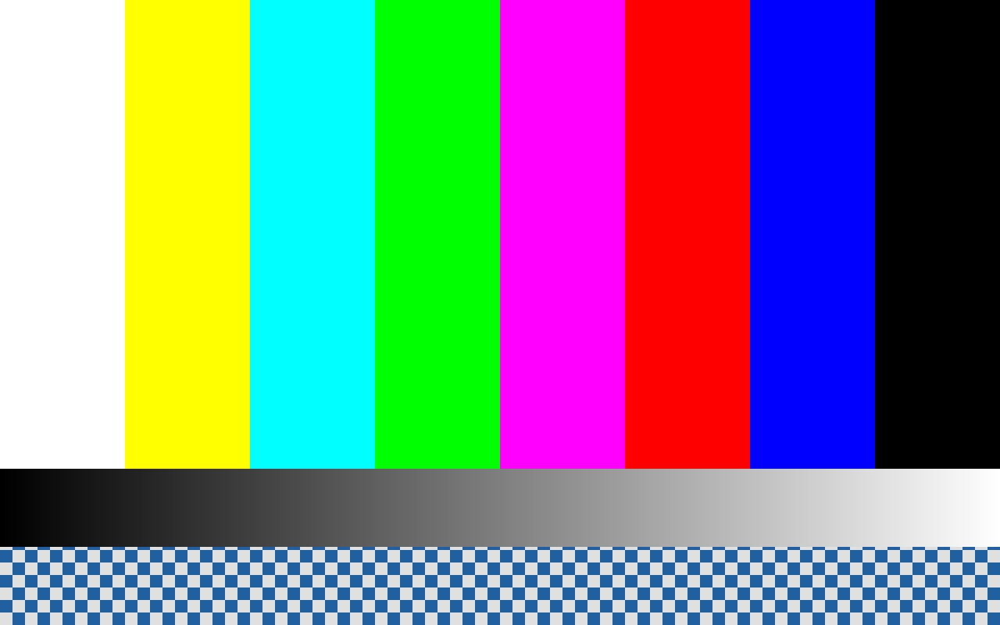

# DEMO — la boucle invité → émulateur, preuve visuelle et numérique

**Date : 2026-11-13 (première version 2026-11-12). Machine : PC Linux, SDP QNX
8.0 (`~/qnx800`), QEMU 8.2.2, KVM.**

Cette page consigne la **preuve** que le pilote invité Toile peint dans
l'émulateur : l'invité QNX dessine sa mire dans le framebuffer virtio-gpu, et
**QEMU l'affiche** ; une capture de cet affichage, analysée numériquement,
retrouve la mire.

## La vitrine live (voir la boucle en fonctionnement)

- invité : QNX 8.0 sous QEMU 8.2.2, `-vga none -device virtio-gpu-pci -vnc :12`,
  IFS construit depuis `guest/` — le pilote publie `/dev/gpu0`, un client
  ordinaire l'ouvre, peint la mire et la présente ;
- vitrine : `qnx-emu/web.py` lit l'écran par `screendump` sur le moniteur QEMU
  et la console par le journal série ;
- unités systemd fournies dans `qemu/systemd/` :

```sh
systemctl --user enable --now toile-qemu.service toile-web.service
```

- accès : `https://baptiste-ms-7d18.tail3a8bdf.ts.net:8443/toile/`
  (`tailscale funnel --set-path=/toile http://127.0.0.1:8111`) ;
- page du site : `site/emulator-live.html` (écran + console, rafraîchis toutes
  les 2 s).

## Méthode (une commande, sans vitrine)

```sh
cd ~/Bureau/toile
./qemu/run-demo.sh   # compile pilote + client, construit l'IFS, démarre QEMU,
                     # fait ouvrir /dev/gpu0 et peindre la mire par un client,
                     # capture l'affichage, vérifie la capture, tranche le verdict
```

Le détail de la procédure VM est factorisé dans `qemu/probe-driver.sh` (source
unique).

## Ce que montre la mire

`toile_pattern_paint()` (partagé pilote / client, zéro duplication) peint :

- **8 barres verticales** sur les 3/4 supérieurs (blanc, jaune, cyan, vert,
  magenta, rouge, bleu, noir) ;
- une **rampe de gris** sur le 1/8 suivant ;
- un **damier de 16 px** en bas (adressage pixel par pixel).

Analyse numérique de la capture : 8 barres aux couleurs pures, rampe continue,
damier présent, ~90,6 % de pixels non noirs.

## Journal série (extrait)

```
toile-gpu: device up: 0 queues, msix=yes, features=0x100000000
toile-gpu: scanout 0 mode 1280x800 (enabled)
toile-gpu: framebuffer 1280x800 fmt=2 stride=5120 pa=0x5e003000
toile-gpu: scanout 0 <- resource 1 (1280x800)
toile-gpu: serving /dev/gpu0
TOILE: /dev/gpu0 pret
toile-gpu: resmgr: open -> rc=0
CLIENT: /dev/gpu0 ouvert (fd=3)
CLIENT: mire peinte et presentee
CLIENT: OK
client rc=0
```

## Capture



- Taille : **1280 × 800** (= le mode du scanout annoncé par `GET_DISPLAY_INFO`).
- Interprétation : ces pixels ont été écrits **dans l'invité**, au travers de la
  ressource virtio-gpu (backing + `SET_SCANOUT` + `TRANSFER_TO_HOST_2D` +
  `RESOURCE_FLUSH`), et rendus **par l'hôte QEMU** — la boucle
  « invité → émulateur » est fermée pour l'affichage.

## Preuve numérique : ce qui est prouvé, et ce qui ne l'est pas

| Sens | Commande | Verdict |
|---|---|---|
| invité → hôte | `TRANSFER_TO_HOST_2D` (0x0105) | **prouvé** : la mire est rendue par QEMU, la capture est analysée pixel par pixel (preuve B) |
| hôte → invité | `TRANSFER_FROM_HOST_3D` (0x0206) | **refusé par le périphérique** (`0x1200`, `ERR_UNSPEC`) : la série 3D n'existe pas sans virgl |

Détail vérifié dans l'en-tête noyau (`/usr/include/linux/virtio_gpu.h`) : il
**n'existe pas** de commande `TRANSFER_FROM_HOST_2D`. La lecture hôte → invité
n'existe que dans la série 3D (`0x0206`), qui exige virgl. Le pilote l'annonce
donc explicitement (`REFUSEE_PAR_LE_PERIPHERIQUE`) au lieu de laisser croire à
une preuve : les deux empreintes FNV-1a sont identiques, mais leur égalité ne
prouve rien (le périphérique n'a pas recopié). La preuve du transit repose donc
sur la preuve B (comparaison de la capture).

## Limite (dite, pas cachée)

- **`/dev/gpu0` s'ouvre** correctement depuis un client ordinaire. La cause du
  `SIGSEGV` était `resmgr_attach()`, qui conserve les *pointeurs* vers les tables
  de gestionnaires : elles sont désormais statiques, plus sur la pile.
- **L'intégration Screen** (bureau QNX complet) exige le BSP Screen
  (`libWFDplatform`, `wfd-server`), hors SDP libre.
- **Pas de clavier** : virtio-input n'est pas branché (la mire ne réagit pas aux
  touches).